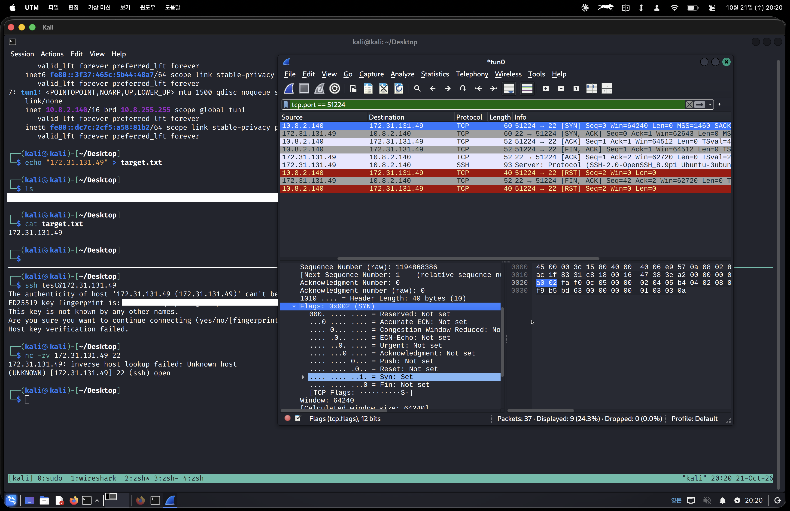
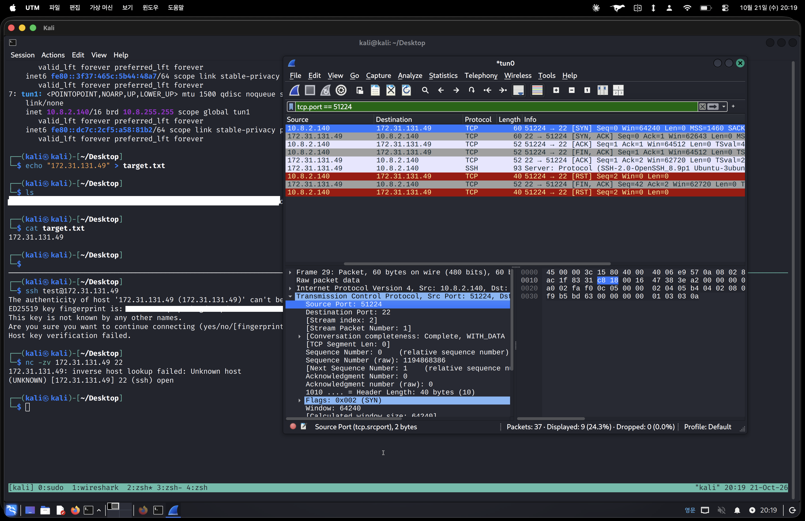

 
## 1. 목표
 
TCP 연결이 시작될 때 오가는 3-Way Handshake 패킷을 와이어샤크로 직접 확인
 
`3-Way Handshake` : TCP가 데이터를 보내기 전에 상대가 받을 준비가 되었는지 3번 주고받으며 확인하는 과정
 
## 2. 실습 환경
 
- Kali Linux (VM), Wireshark
- 실습 서버 22번 포트 (SSH)
- tmux로 터미널 나눠서 사용 (0번 openvpn, 1번 와이어샤크, 2번 명령어)
## 3. 실습 과정
 
와이어샤크 캡처 시작 -> 서버 22번 포트로 연결 시도 -> 패킷 확인
 
```bash
nc -zv <실습 서버 IP> 22
```
 
- `nc` : netcat, 네트워크 연결을 직접 만들어보는 도구
- `-z` : 데이터는 보내지 않고 연결만 확인
- `-v` : 결과를 자세히 출력
```
tcp.port == 51224
```
 
- 와이어샤크 필터, 내 쪽 출발 포트로 이번 연결 패킷만 보기

 
> 공개할 필요 없는 정보는 마스킹
 
SSH 아이디를 몰라도 확인 가능 -> Handshake는 **로그인보다 먼저** 일어나기 때문
 
## 4. 결과 분석
 

 
`Seq` : 내가 보내는 데이터의 번호표
 
`Ack` : 받았으니 다음 번호를 보내달라는 답장
 
1. 칼리 -> 서버 `SYN` (Seq 0) -> 연결해도 되나요?
2. 서버 -> 칼리 `SYN, ACK` (Seq 0, Ack 1) -> 요청 받았습니다
3. 칼리 -> 서버 `ACK` (Seq 1, Ack 1) -> 확인, 연결 완료

** 왜 필요한가
 
TCP는 UDP와 다르게 데이터를 빠짐없이, 순서대로 보내는 것이 목적 -> 보내기 전에 상대가 받을 준비가 되었는지 확인해야 함
 
**추가로 보인 것**
 
- `FIN, ACK` : `nc -z`는 연결만 확인하고 바로 끊음 -> 시작은 SYN, 종료는 FIN
- SSH 배너 : 연결만 했는데 서버가 `SSH-2.0-OpenSSH_8.9p1 Ubuntu`를 보내옴 -> 버전과 OS 노출 (배너 그래빙)
## 5. 방어자 관점
 
- SYN만 계속 오고 ACK이 없음 -> **SYN Flooding** (연결을 완료하지 않아 서비스를 못 쓰게 만드는 공격) 의심
- 한 IP에서 여러 포트로 SYN -> RST 반복 -> **포트 스캔** 의심 (공격자의 정보 수집 단계)
- 배너에 버전 정보 노출 -> 공격자가 그 버전의 알려진 취약점을 찾을 수 있음
**예방**
 
- 서비스는 최신 버전으로 유지
- 불필요한 배너 정보 숨기기
## 6. 배운 점
 
- 네트워크관리사 2급으로 이론은 공부했지만 실제 패킷이 오가는 것은 처음 확인
- 연결만 해도 서버 정보가 노출될 수 있다는 것을 패킷으로 직접 봄
- 다음 글 : nmap 포트 스캔 흔적이 패킷에 어떻게 남는지 분석
 
