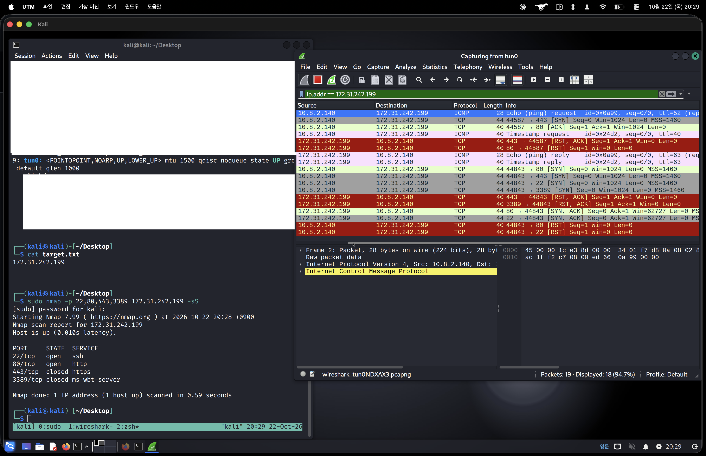
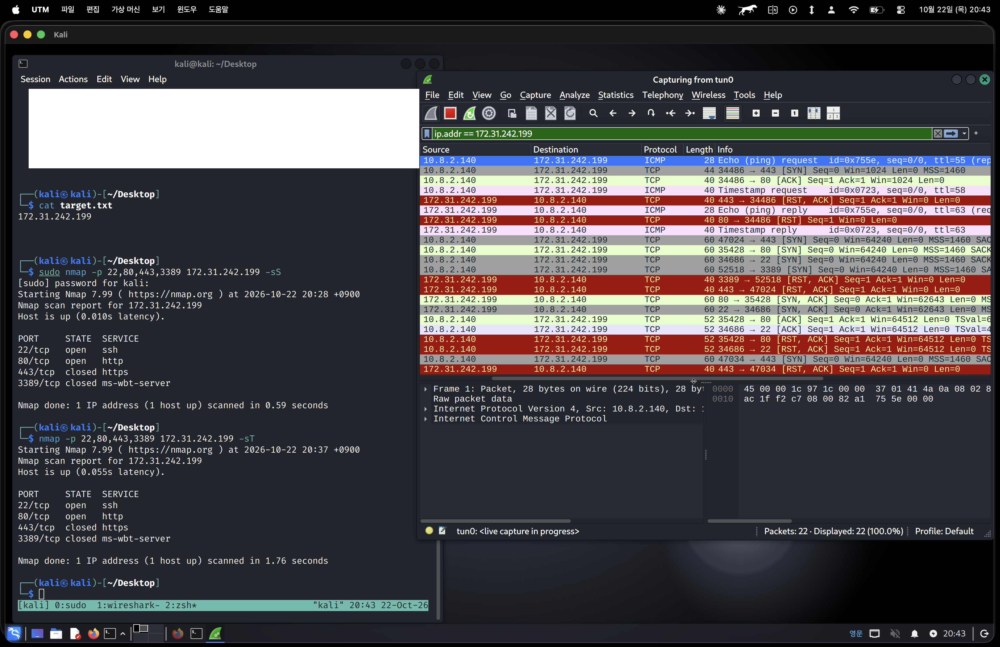

 
## 1. 목표
 
nmap 스캔 방식(`-sS`, `-sT`)에 따라 패킷이 어떻게 다르게 오가는지 와이어샤크로 확인
 
`포트 스캔` : 서버의 어떤 포트(문)가 열려 있는지 찾는 것, 공격자의 정보 수집 단계
 
## 2. 실습 환경
 
- Kali Linux (VM), Wireshark, tmux, OpenVPN
- 실습 서버 포트 22, 80, 443, 3389
## 3. 실습 과정
 
**1. SYN 스캔**
 
```bash
sudo nmap -p 22,80,443,3389 <실습 서버 IP> -sS
```
 
- `sudo` : 일시적으로 관리자 권한으로 실행
- `nmap` : Network Mapper, 네트워크 탐색·포트 스캔 도구
- `-p` : 스캔할 포트 지정
- `-sS` : TCP SYN 스캔, 연결을 끝까지 맺지 않음 (스텔스 스캔)

 
- 22, 80 -> `SYN, ACK` 응답 -> Open
- 443, 3389 -> `RST, ACK` 응답 -> Closed
- 열린 포트에 칼리가 바로 `RST` -> 열렸는지만 확인하면 되니까 연결하지 않고 끊음
**2. Connect 스캔**
 
```bash
nmap -p 22,80,443,3389 <실습 서버 IP> -sT
```
 
- `-sT` : TCP Connect 스캔, 3-Way Handshake를 끝까지 맺고 확인

 
- SYN 스캔 : 열린 포트 `SYN, ACK` 받고 바로 `RST`
- Connect 스캔 : `ACK`으로 연결을 완료한 뒤 `RST, ACK`
## 4. 결과 분석
 
**스캔 전에 서버가 살아있는지 먼저 확인**
 
출발 포트 44587 패킷들은 스캔이 아니라 호스트 확인
 
- ICMP `Ping`, `Timestamp` : 포트 번호 없이 서버가 대답하는지만 확인
- 443에 `SYN`, 80에 `ACK` : TCP로도 같이 확인
- 방화벽이 Ping을 막는 경우가 많음 -> 여러 방법으로 동시에 확인하고 하나라도 대답하면 "Host is up"
**ACK 핑**
 
연결한 적 없는데 `ACK`이 오면 서버는 `RST`로 대답함 -> 대답이 오면 살아있는 서버
 
택배 시킨 적 없는데 "택배 왔습니다" 하고 떠보는 것과 비슷
 
**왜 -sT는 sudo가 필요 없을까**
 
- `-sS` : nmap이 패킷을 직접 만들어 보내서 관리자 권한 필요
- `-sT` : 운영체제의 일반 연결 방식을 그대로 사용 -> 권한 불필요, 대신 느리고 로그에 남기 쉬움
**Win 값**
 
`Win` : "지금 한 번에 이만큼 받을 수 있다"는 수신 버퍼 남은 공간 크기 (흐름 제어, Flow Control)
 
- `-sS` : 칼리 Win=1024 -> nmap이 직접 만든 패킷, 데이터를 주고받을 생각이 없어서 작은 값
- `-sT` : 칼리 Win=64240 -> 리눅스가 평소 쓰는 값
## 5. 방어자 관점
 
**스캔 의심 단서**
 
- 한 IP에서 짧은 시간에 여러 포트로 `SYN` (4개 포트를 0.59초 만에)
- `-sS`는 같은 출발 포트(44843) 하나로 여러 포트를 확인
- 스캔 직전 Ping, Timestamp, `SYN`, `ACK`이 한꺼번에 오는 nmap 특유의 모양
- Win=1024 -> 일반적인 리눅스 값이 아님
**서버 로그만 보면 안 되는 이유**
 
- `-sS`는 연결을 완성하지 않아 SSH 같은 서버 프로그램 로그에 남지 않을 수 있음
- `-sT`는 연결을 끝까지 맺어서 서버 로그에 남을 수 있음
- 스텔스 스캔을 잡으려면 네트워크 패킷 자체를 감시하는 IDS 같은 장비도 함께 봐야 함
## 6. 배운 점
 
- 플래그 하나만 바꿔도 패킷 모양이 달라짐 -> 공격자 명령어 하나가 방어자 화면에서 어떻게 보이는지 확인
- 공격 실습에서는 결과만 봤는데, 패킷으로 보니 관제에서 무엇을 봐야 하는지 감이 잡힘
- 최근 PHP 원격 코드 실행 취약점(CVE-2026-109618, CVE-2026-109619) 소식을 봄 -> 버전 정보가 노출되면 이런 취약점과 바로 연결될 수 있어 최신 버전 유지가 중요
- 다음 글 : `-sV`로 서비스 버전 확인, 배너 그래빙
 
