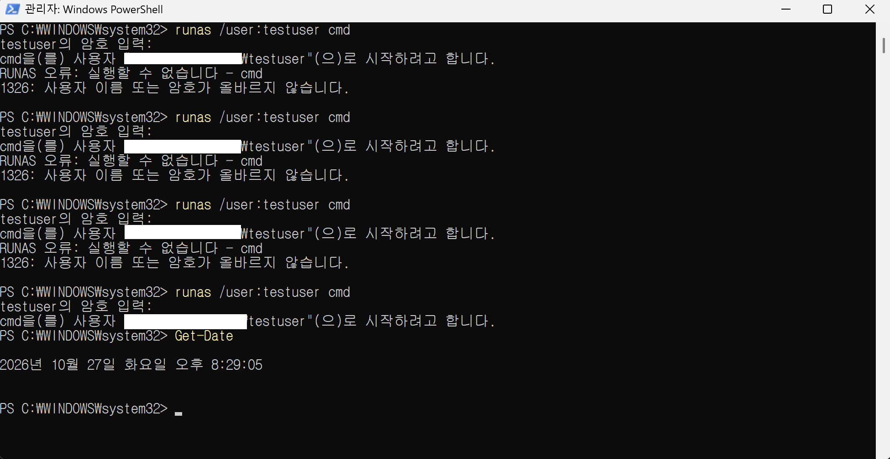
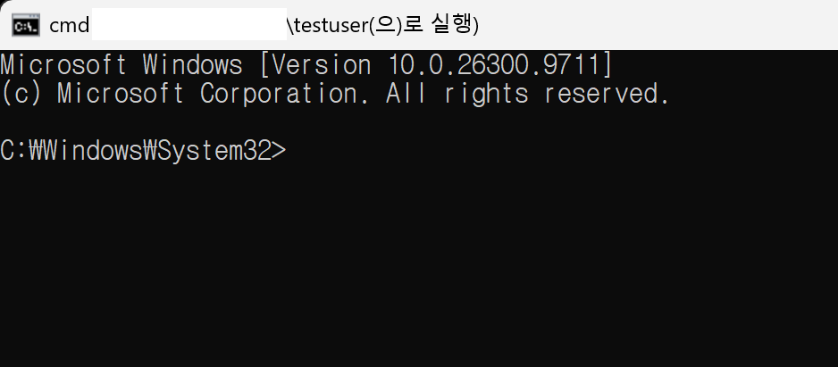
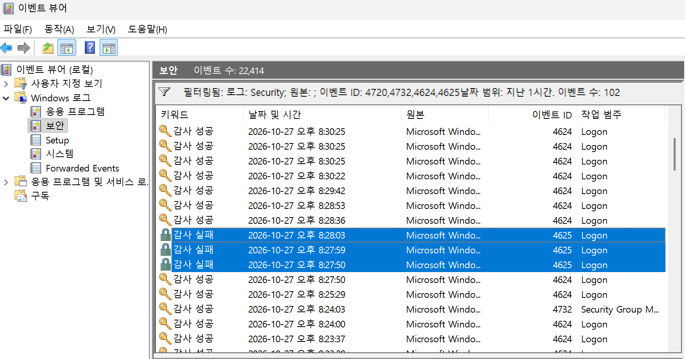
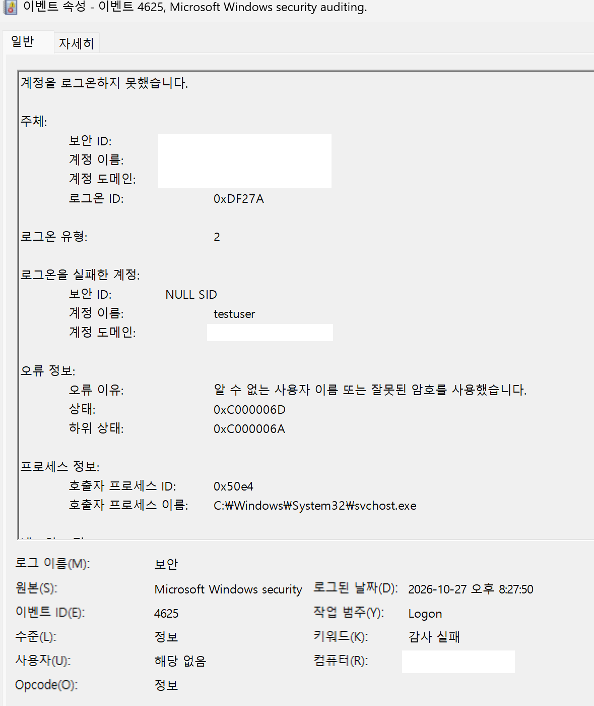
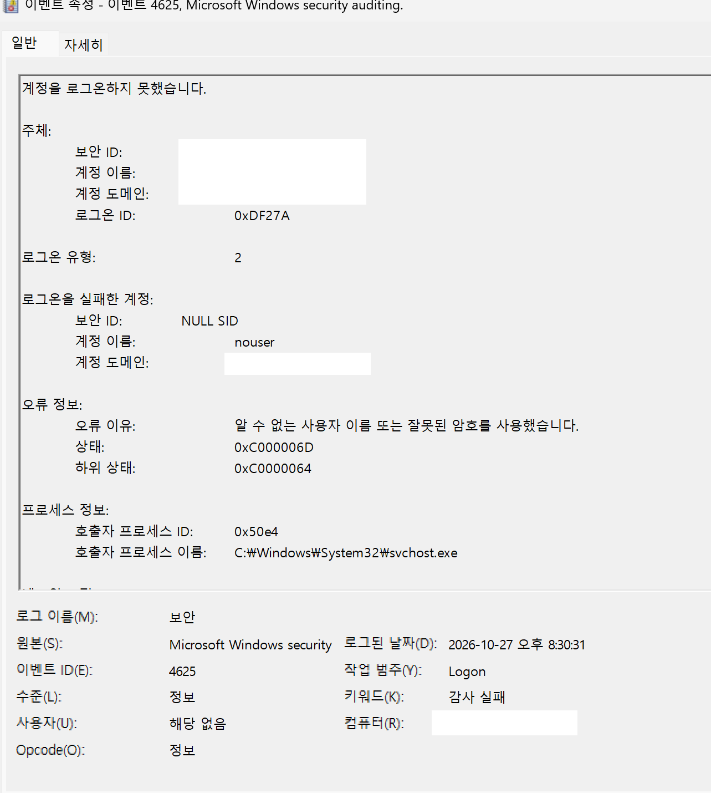
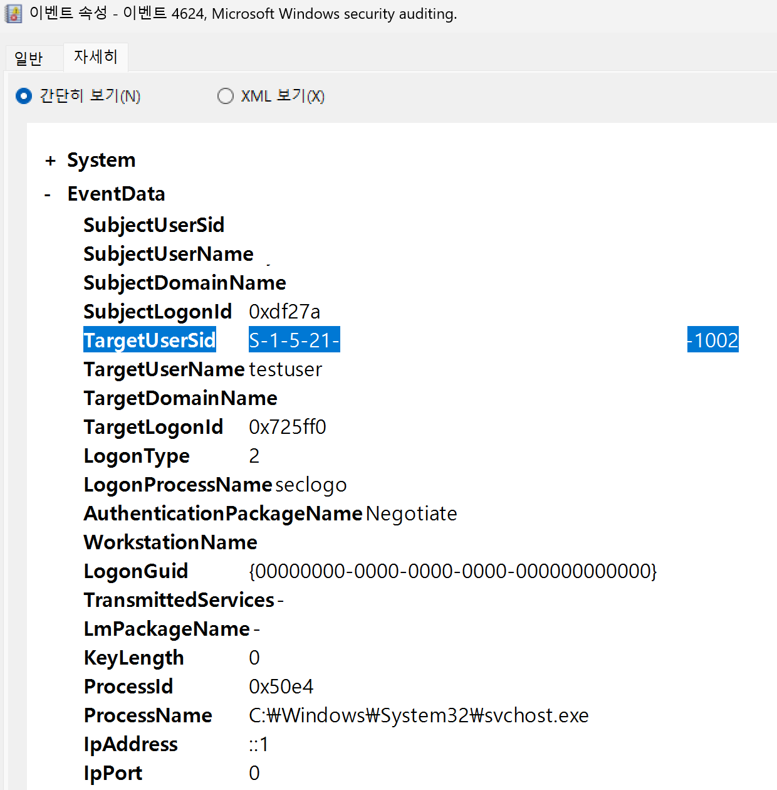
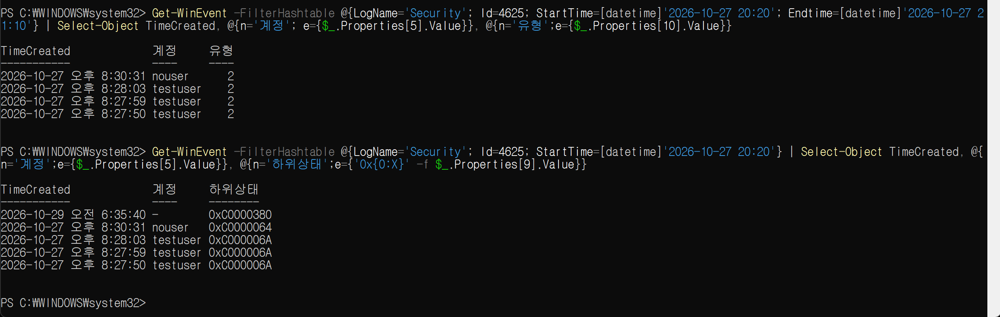
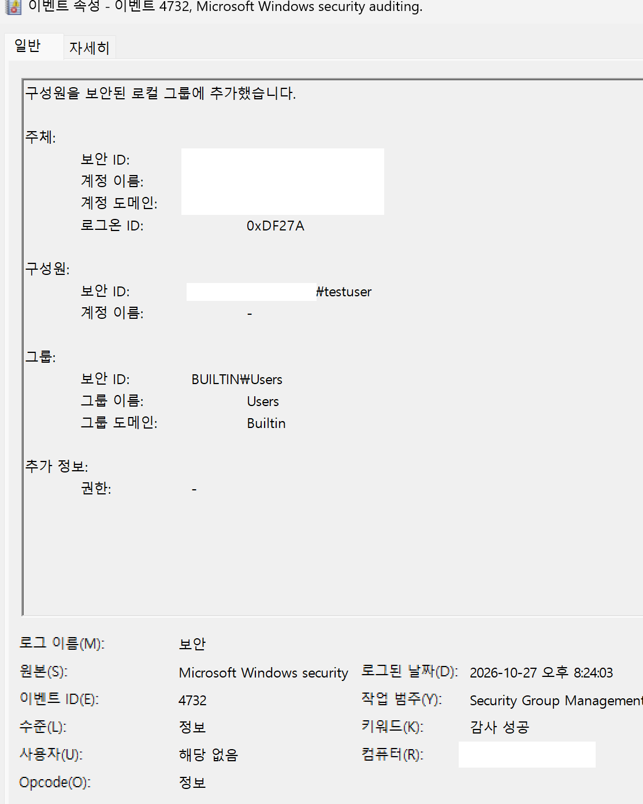

 
## 1. 목표
 
일부러 로그인 실패를 만들고 Windows가 남긴 보안 로그(4625)를 직접 찾아서 읽기
 
`4625` : 로그인 실패 이벤트 ID (성공은 4624)
 
`감사 정책` : Windows가 어떤 보안 행동을 보안 로그에 기록할지 정하는 설정
 
## 2. 실습 환경
 
- Windows 11 (내 PC), 관리자 PowerShell, 이벤트 뷰어
- 실습용 로컬 계정 testuser (내 계정은 마이크로소프트 계정이라 runas 실습에 불편)
## 3. 실습 과정
 
감사 정책 확인 -> 실습 계정 생성 -> 로그인 실패 만들기 -> 로그 확인
 
**1. 감사 정책 확인**
 
```powershell
auditpol /get /subcategory:"로그온"
```
 
- `auditpol` : 감사 정책 확인·설정 (Audit + Policy)
- 결과 "성공 및 실패" -> 4624, 4625 모두 기록됨
- 기록이 꺼져 있으면 공격이 있어도 흔적이 없음 -> 관제는 기록이 켜져 있는지부터 확인
- 보안 로그는 관리자 권한으로만 볼 수 있어서 관리자 PowerShell 사용

**2. 실습 계정 만들기**
 
```powershell
$pw = Read-Host -AsSecureString
New-LocalUser -Name "testuser" -Password $pw
Add-LocalGroupMember -Group "Users" -Member "testuser"
```
 
- `Read-Host -AsSecureString` : 비밀번호를 입력받아 $pw에 저장 (화면에 안 보임)
- `New-LocalUser` : 로컬 계정 생성 -> 4720 기록
- `Add-LocalGroupMember` : Users 그룹에 추가 -> 4732 기록
공격자가 몰래 계정을 만들거나 관리자 그룹에 넣어도 번호가 남음

- 실습 계정 만드는 방법은 검색을 통해 생성
 
**3. 로그인 실패 만들기**
 
```powershell
runas /user:testuser cmd
```
 
- `runas` : 다른 계정으로 프로그램 실행
- `/user:testuser` : 실행할 계정
- `cmd` : 실행할 프로그램


- testuser 비밀번호 3번 틀림 -> "1326: 사용자 이름 또는 암호가 올바르지 않습니다"
- 4번째에 맞는 비밀번호 -> testuser로 cmd 실행



 
- 비교용으로 존재하지 않는 계정(nouser)으로도 runas 시도
  -> 화면에는 testuser 때와 똑같은 1326 에러 (캡쳐 없음)
  
- Windows 11은 기본으로 10번 틀리면 계정 잠김(4740) -> 3번만 시도

**4. 이벤트 뷰어로 확인**
 
`Win + R` -> `eventvwr.msc` -> Windows 로그 -> 보안 -> 현재 로그 필터링 -> 이벤트 ID `4720,4732,4624,4625` -> 지난 1시간
 

 
- 4625 3개 확인 -> 일부러 틀린 3번
- 사이사이 4624가 많음 -> Windows 서비스가 백그라운드에서 남긴 로그인 -> 하나씩 열어서 확인

## 4. 결과 분석
 
**화면은 같은데 로그가 다름**
 

 

 
testuser

- 로그온 유형 : 2
- 보안 ID : NULL SID
- 상태 : 0xC000006D
- 하위 상태 : **0xC000006A**

nouser

- 로그온 유형 : 2
- 보안 ID : NULL SID
- 상태 : 0xC000006D
- 하위 상태 : **0xC0000064**

-> 로그온 유형, 보안 ID, 상태는 같고 하위 상태만 다름
 
- `0xC000006A` : 계정은 있지만 비밀번호 틀림
- `0xC0000064` : 존재하지 않는 계정
예상과 다른 점 : 없는 계정만 NULL SID일 줄 알았는데 둘 다 NULL SID -> 구분할 수 있는 칸은 하위 상태 하나뿐
 
**성공한 로그인 (4624)**
 

 
- SubjectUserName : runas를 실행한 나 (로그인을 요청한 쪽)
- TargetUserName : testuser (로그인된 계정)
- LogonType `2` : 대화형 (PC 앞에서 직접 로그인)
- LogonProcessName `seclogo` : runas가 쓰는 보조 로그온 서비스
- IpAddress `::1` : 자기 자신 (127.0.0.1과 같은 뜻)
실제 원격 공격이라면 외부 IP와 로그온 유형 3(네트워크) 또는 10(RDP)이 찍힘
 
**PowerShell로 한 번에 보기**

이벤트 뷰어는 하나씩 열어야 해서 로그가 많으면 오래 걸림 -> 4625만 가져와서 필요한 칸만 출력

```powershell
Get-WinEvent -FilterHashtable @{LogName='Security'; Id=4625; StartTime=[datetime]'2026-10-27 20:20'} | Select-Object TimeCreated, @{n='계정';e={$_.Properties[5].Value}}, @{n='하위상태';e={'0x{0:X}' -f $_.Properties[9].Value}}
```

- `Get-WinEvent` : 보안 로그에서 4625만 가져오기
- `| Select-Object` : 시간, 계정, 하위 상태 칸만 골라서 출력



- testuser 3줄 0xC000006A, nouser 0xC0000064 -> 한눈에 비교
- 맨 위 0xC0000380은 실습과 무관 (10/29 아침 PIN 잘못 입력)

**이름으로 거르면 놓치는 로그**

실습 시간 동안의 로그 중 testuser, nouser 이름이 들어간 것만 시간순으로 출력

```powershell
Get-WinEvent -FilterHashtable @{LogName='Security'; Id=4720,4732,4624,4625,4726; StartTime=[datetime]'2026-10-27 20:20'; EndTime=[datetime]'2026-10-27 21:10'} | Where-Object { $_.Message -match 'testuser|nouser' } | Sort-Object TimeCreated | Select-Object TimeCreated, Id
```

- `Where-Object` : 이름이 들어간 로그만 남기기
- `Sort-Object` : 시간순 정렬

```text
TimeCreated              Id
2026-10-27 오후 8:23:20  4720
2026-10-27 오후 8:27:50  4625
2026-10-27 오후 8:27:59  4625
2026-10-27 오후 8:28:03  4625
2026-10-27 오후 8:28:36  4624
2026-10-27 오후 8:30:31  4625
2026-10-27 오후 8:49:13  4726
```

그룹 추가 로그(4732)가 결과에서 빠짐



- 4732를 열어보니 계정 이름 칸은 `-` (비어 있음), 보안 ID에만 testuser가 있음
- 이름으로만 검색하면 로그를 놓칠 수 있음 -> 관제에서 말하는 **미탐**

## 5. 방어자 관점

- 0xC000006A가 한 계정에 반복 -> **무차별 대입(Brute Force)** 의심
- 0xC0000064가 여러 계정 이름으로 반복 -> **계정 이름 추측** 의심
- 0xC000006A가 여러 계정에 한두 번씩 -> **패스워드 스프레이** 의심 (비밀번호 하나를 여러 계정에 넣어보기)
- 4624는 Windows도 스스로 남김 -> 로그온 유형, 계정, IP를 같이 봐야 함
- 이름뿐 아니라 보안 ID로도 검색해야 놓치지 않음

## 6. 배운 점

- 감사 정책이 켜져 있어야 로그인 성공(4624)·실패(4625)가 남음
- 화면 에러는 같아도 로그의 하위 상태로 공격을 구분할 수 있음
- 예상과 달라도 실제 기록을 믿어야 함 (NULL SID)
- PowerShell 명령어는 찾아서 썼고, 직접 쓰려면 연습이 더 필요함
- 다음 글 : 원격 로그인, 로그 삭제(1102) 흔적 확인
 
