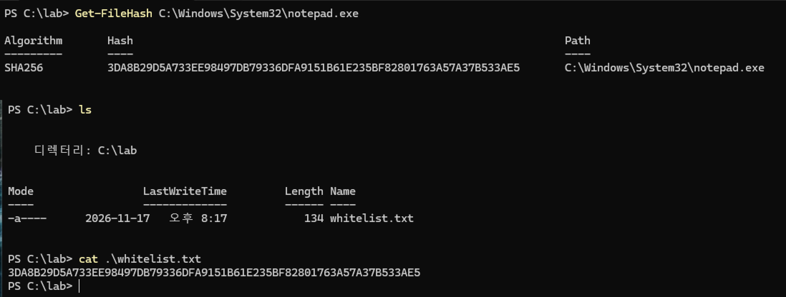
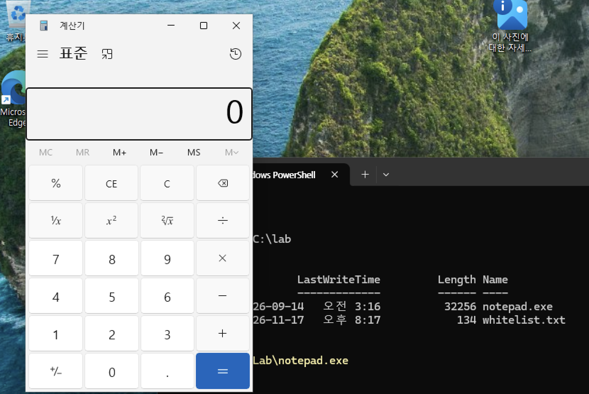
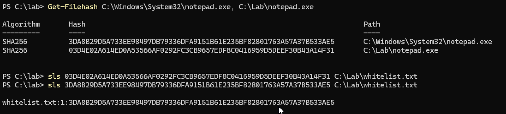
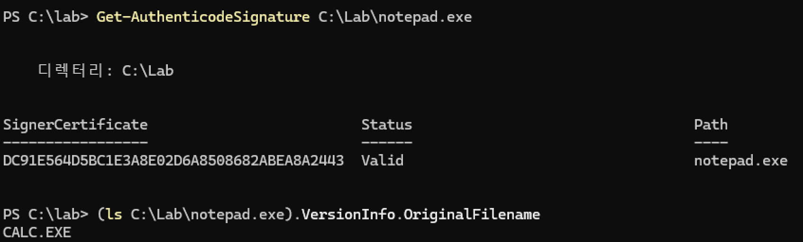
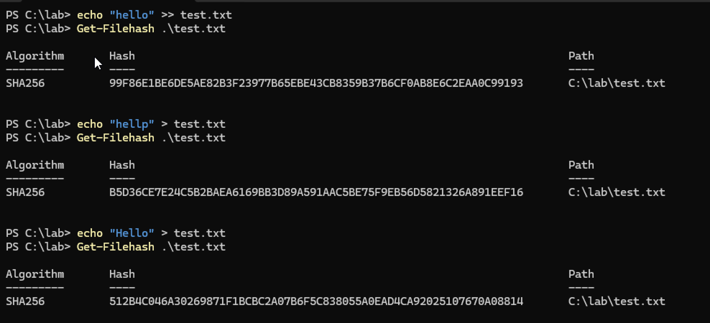
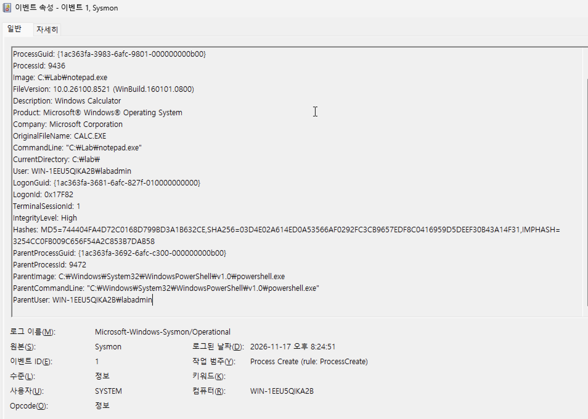

## 1. 목표

정상 파일의 해시로 화이트리스트를 만들고, 이름을 바꾼 위장 파일을 해시로 구분할 수 있는지 확인

`화이트리스트` : 검증된 정상 파일 목록이며 목록에 없으면 의심함 (블랙리스트는 반대로 나쁜 것 목록)

`해시` : 파일 내용으로 계산한 고정 길이의 값이며 파일의 지문 역할

## 2. 실습 환경

- Windows 11 (맥북 UTM 가상머신, 인터넷 차단)
- PowerShell, 이벤트 뷰어 (Sysmon)
- 악성코드 없이 Windows 기본 프로그램(메모장, 계산기)만 사용

## 3. 실습 과정

정상 파일 등록 -> 위장 파일 생성 -> 해시 비교

**1. 화이트리스트 만들기**

```powershell
Get-FileHash C:\Windows\System32\notepad.exe
(Get-FileHash C:\Windows\System32\notepad.exe).Hash > C:\Lab\whitelist.txt
```

- `Get-FileHash` : 파일 해시 계산 (기본 SHA256)
- `(...).Hash >` : 해시 값만 꺼내서 파일에 저장



정상 메모장의 해시를 whitelist.txt(허용 목록)에 저장했다

**2. 위장 파일 만들기**

```powershell
cp C:\Windows\System32\calc.exe C:\Lab\notepad.exe
C:\Lab\notepad.exe
```

- `cp` : 복사 (Copy-Item), 복사하면서 이름을 notepad.exe로 바꿈



이름은 메모장인데 실행하면 계산기가 열렸다

수정 날짜도 원본 그대로(2026-09-14) 따라와서 날짜만으로는 새로 생긴 파일인지 알 수 없었음

**3. 해시 비교**

```powershell
Get-FileHash C:\Windows\System32\notepad.exe, C:\Lab\notepad.exe
sls <해시값> C:\Lab\whitelist.txt
```

- `sls` : 파일 안에서 글자 찾기 (Select-String, 리눅스 grep과 같음)



- 진짜 메모장 해시 -> 화이트리스트 1번째 줄에서 발견 -> 허용
- 가짜 메모장 해시 -> 아무것도 나오지 않음 -> 목록에 없는 파일

## 4. 결과 분석

**서명과 원래 이름 확인**

```powershell
Get-AuthenticodeSignature C:\Lab\notepad.exe
(ls C:\Lab\notepad.exe).VersionInfo.OriginalFilename
```



- 서명 Status : `Valid` -> 원래 Microsoft 계산기라서 서명은 정상
- 원래 이름 : `CALC.EXE` -> 겉은 메모장, 속은 계산기

**무엇이 위장 파일을 잡았나**

- 파일 이름 -> notepad.exe -> 못 잡음
- 디지털 서명 -> Microsoft, Valid -> 못 잡음
- 해시 (화이트리스트) -> 목록에 없음 -> 잡음

**글자 하나만 바꿔도 해시는 완전히 바뀜**

```powershell
echo "hello" > test.txt
Get-FileHash .\test.txt
```



hello, hellp, Hello 세 해시는 비슷한 부분이 전혀 없음 -> 파일을 조금만 수정해도 화이트리스트에서 걸림

## 5. 방어자 관점

Sysmon -> 이벤트 ID `1` (프로세스 생성) 필터



- Image : `C:\Lab\notepad.exe` -> 정상 경로(System32)가 아님
- OriginalFileName : `CALC.EXE` -> 이름과 실제가 다름 -> 위장 (MITRE ATT&CK T1036)
- Hashes : SHA256 `03D4E02A...` -> PowerShell로 구한 가짜 파일 해시와 같음
- ParentImage : `powershell.exe` -> 누가 실행했는지 확인
- 파일을 직접 열지 않아도 로그에 찍힌 해시를 화이트리스트와 대조할 수 있음

**대응 할 수 있는것**

- 화이트리스트에 없는 해시의 파일은 실행 차단 또는 격리
- 같은 해시가 다른 PC에도 있는지 검색

**예방**

- 정상 파일 해시 목록을 업데이트할 때마다 최신으로 유지
- 이름이 아니라 해시, 경로, 서명을 함께 확인하는 정책 적용

## 6. 배운 점

- 화이트리스트는 이름이나 서명이 아니라 해시로 정상 파일을 정의하기 때문에 이름을 바꾼 위장 파일도 잡을 수 있다
- 서명이 정상이어도 "내가 허용한 그 파일"이라는 보장은 없음
- WhitelistTotal에서 실습 파일 해시를 검색해 보니 최신 업데이트 빌드라 아직 등록되어 있지 않았음 -> 목록에 없다고 바로 악성은 아니며 서명, 경로, 원래 이름을 함께 확인해야 함
